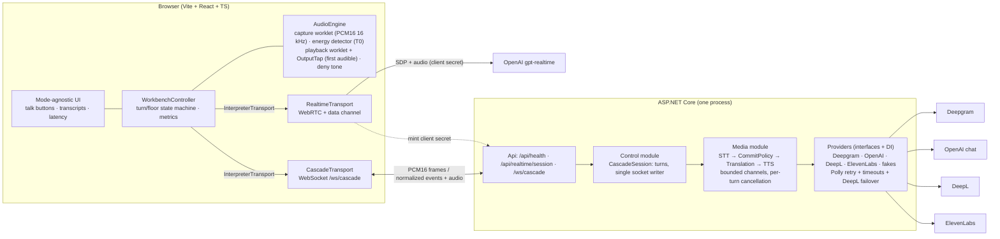

# AI Interpreter Workbench: Realtime API vs. Cascade

A browser workbench that runs two live-interpretation architectures side by side, instruments them
identically, and measures them:

- **Realtime:** OpenAI `gpt-realtime`, voice in / voice out, browser → OpenAI over WebRTC.
- **Cascade:** streaming Deepgram STT → OpenAI translation (streamed) → ElevenLabs TTS, composed on
  an ASP.NET Core backend, browser ↔ backend over a WebSocket.

Two push-to-talk buttons (one per speaker, English ↔ Spanish), live source and target transcripts,
per-stage latency on screen, a mode toggle that can switch mid-session (queued until the turn ends),
and an evaluation harness that produces [`harness/results/report.md`](harness/results/report.md). The
recommendation is in [`docs/comparison.md`](docs/comparison.md). A follow-up on clinic register and
terminology (formality + glossary) is in [`docs/translation-controls.md`](docs/translation-controls.md).

> Candidate take-home, not an official Boostlingo product.

## Setup

**Prerequisites** (Windows or macOS):

- .NET 10 SDK (`dotnet --version` → 10.x). If no SDK is on your PATH, `scripts/dotnet.mjs` also
  accepts a repo-local SDK in `.dotnet/` (Microsoft's `dotnet-install` script with
  `-InstallDir .dotnet` / `--install-dir .dotnet`).
- Node.js 22 LTS or newer.
- Chrome or Edge (microphone + WebRTC).

**Keys:** copy `.env.example` to `.env` in the repo root and paste four keys:

```
OpenAI__ApiKey=...      # gpt-realtime, translation, the evaluation judge
Deepgram__ApiKey=...    # streaming STT
ElevenLabs__ApiKey=...  # streaming TTS (needs text_to_speech permission)
DeepL__ApiKey=...       # secondary translator and 429 failover target
```

`.env` is gitignored. The backend loads it at startup (DotNetEnv); real environment variables win.
If a key is missing the app still starts and shows a **Configuration missing** panel naming it.

**Install:**

```bash
npm install
npx playwright install chromium   # only for e2e tests and the harness
```

## Run

```bash
npm run dev      # backend on :5080 + Vite on :5173 → open http://localhost:5173
npm test         # xUnit (server) + vitest (client, harness metrics); includes 5 live provider
                 # contract tests (fractions of a cent) unless WORKBENCH_SKIP_CONTRACT=1 or keys are missing
npm run e2e      # Playwright (fake-provider specs are free; real-provider specs cost cents and skip without keys)
npm run report   # rebuild harness/results/report.md from saved harness runs
```

Useful URL parameters: `?mode=realtime`, `?strategy=clause`, `?controls=off` (initial value of the header's
**Clinic terms** toggle for the translation controls: formal register + clinic glossary, on by default; see
[`docs/translation-controls.md`](docs/translation-controls.md)), `?providers=fake` (server-side fake
providers, no keys, no cost), `?providers=fake&faults=translation:429` (inject failures: `429`,
`timeout`, `empty`, `500`, `400` for `stt`/`translation`/`tts`), `?transport=fake` (client-only
simulator).

## Test Runs

The **Test Runs** tab runs chosen replay clips on one setup (Realtime, Cascade segment, Cascade
clause or Cascade with DeepL; Clinic terms on or off) and saves each run to
`harness/results/test-runs/<id>.json` with every turn and a summary: mouth-to-ear p50/p95 against the
target, access time, source and target WER, and cost. It shows a cost estimate and asks before
starting. Open a saved run for its turns, or select two and **Compare selected** for a per-clip
difference. Add `?providers=fake` to try it without API cost.

## Architecture



- **One transport interface, two implementations.** The UI and controller consume only the
  normalized event schema (`contracts/event-samples.json`, round-tripped by both the C# and TS
  contract tests) plus four transport signals (access, first audible, playback started/ended).
- **Measurement.** T0 is the last voiced frame from a client-side energy detector, not the button
  release. First audible is measured at the playback tap (cascade) or an AnalyserNode on the remote
  WebRTC track (Realtime). Headline = `first_audible − T0` on the browser clock; the server reports
  stage durations only.
- **Turn model.** Consecutive playback: the cascade translates and synthesizes while the speaker is
  still talking and starts playing on release. A press while the floor is busy is denied (two-note
  tone, shake, "Floor busy"), never queued.
- Details: [`docs/architecture.md`](docs/architecture.md) (index of the as-built HLA, LLA and sequence diagrams), decisions in [`docs/decisions.md`](docs/decisions.md), run log in [`PROGRESS.md`](PROGRESS.md).

## Why C# / .NET

The brief prefers .NET; it also fits the problem. The cascade is a concurrent streaming pipeline:
`System.Threading.Channels` gives bounded, back-pressured stage hand-offs, `IAsyncEnumerable` makes
every provider stream a plain `await foreach`, and `CancellationToken` linking gives one switch that
stops every stage of a turn. Polly is the standard resilience library, ASP.NET Core WebSockets and
`ClientWebSocket` cover both ends of the media path, and DI makes provider selection a config value.
One process keeps the control and media modules separate in code while staying simple to run.

## Swapping a provider

Providers sit behind `ISttProvider`, `ITranslationProvider`, `ITtsProvider` (`server/src/Workbench.Core/Contracts`).

- **Use a different registered provider:** change `Providers` in
  `server/src/Workbench.Api/appsettings.json` (e.g. `"Translation": "deepl"`), or per session from the
  URL (`?providers=translation:deepl`). The harness ran DeepL as primary this way, with no code change.
- **Add a provider:** implement the interface in `Workbench.Providers/<Vendor>/`, register the class in
  `Program.cs` (`providers.AddTranslation("vendor", sp => ...)`), and add its key name to
  `CascadeProviderFactory.Keys` (the health check and config panel read the same table). For
  translation and TTS, retry with jitter, first-item and stall timeouts, failover, timing events and
  usage metering come from the pipeline and resilience decorators. STT is a long-lived stream: the
  pipeline applies the final-transcript timeout, and the adapter owns its connect retry (see Deepgram).
- **Add a language pair:** add the language and pair to `Languages` in appsettings.json (see
  [`harness/results/onboarding.md`](harness/results/onboarding.md) for the EN ↔ FR exercise).
  For clinic terminology in the new pair, add a `TranslationControls.Glossary` entry for each direction.
- **Change terminology or register:** edit `TranslationControls` in appsettings.json. DeepL rebuilds its
  glossary on the next turn. The Free plan holds one glossary, and the adapter only replaces its own.

## Known limitations

- **Evaluation scale.** One harness run per configuration: 24 synthetic clips, so p95 rests on 24
  samples. Synthetic speech is cleaner than real callers, so source WER is near 0 here and will not be
  in the field.
- **Measurement asymmetry at the output.** Cascade first-audible includes the device's output
  latency (via `getOutputTimestamp`); Realtime's AnalyserNode sees samples just before it. This
  favors Realtime by tens of ms.
- **Clause commits** are faster but translate mid-sentence fragments, which shows as seams
  ("fell down. and hurt") and lower fluency. Segment is the default.
- **STT final timeout has no retry.** After release there is no audio left to resend, so the
  pipeline keeps what was heard (deviation from architecture §6).
- **429 handling** uses exponential backoff with jitter and ignores `Retry-After` headers.
- **Deny tone pickup.** The deny tone plays while the other speaker's mic is open. Browser echo
  cancellation usually removes it, but on some setups it can reach STT.
- **DeepL cost** in the report uses an unverified rate: deepl.com does not publish the API rate in a readable form (the key here is Free-plan). Other prices were verified on 2026-10-15; Deepgram's is a promotion.
- **Local only.** The WebSocket and endpoints are unauthenticated (localhost). Production needs auth
  in front of the control plane.
- **Soak length.** 5 minutes per mode showed no growth beyond retained transcripts, but cannot rule
  out a slow leak.
- **Browsers.** Automated runs use Playwright's Chromium with an autoplay flag. Audio that a browser
  blocks before a user gesture is started from the first press, but a manual check in desktop Chrome
  is part of MORNING.md. Safari and Firefox are untested.

## Reading the git history

Commits follow [Conventional Commits](https://www.conventionalcommits.org/): `type(scope): subject`.

| Type | Used for | Example |
|---|---|---|
| `feat` | New behaviour | `feat(cascade): segment and clause commit policies as pure classes with xUnit tests` |
| `fix` | Bug fixes, including those found by review passes | `fix(audio): stamp T0 on the capture clock, flush in-flight frames at release, guard press/release race` |
| `test` | Tests added on their own | `test(cascade): pipeline streaming, ordering, cancellation, timeout, empty and 429 failover` |
| `docs` | Documentation | `docs(decisions): status and evidence for D-01 to D-27` |
| `build` | Tooling and scripts | `build: add root npm scripts and cross-platform dotnet launcher` |
| `data` | Measured results (harness runs, reports) | `data(harness): ...` |

Scopes name the area touched: `api`, `client`, `audio`, `state`, `session`, `ui`, `realtime`,
`cascade`, `providers`, `contracts`, `harness`, `report`, `translation`, and the doc name for `docs`.

- **Commits by milestone:** [`docs/build-plan.md`](docs/build-plan.md) maps every commit to its
  milestone, with timestamps.
- **Why a change was made:** [`docs/decisions.md`](docs/decisions.md) (planning decisions D-01 to
  D-27 and changes during the build, C-01 onward, which cite the commits) and `PROGRESS.md`
  "Decisions made during the run".
- **Review fixes:** each review pass ended in `fix(...)` commits, e.g. `99d7815` (T0 clock and
  press/release race), `2cc1516` (session lifecycle hangs), `439ac5f` (Deepgram send race),
  `28e4ab0` and `a2992e0` (architecture review).
- **Useful commands:** `git log --oneline`, `git log --oneline -- server/src/Workbench.Core/Pipeline`
  (history of one area), `git show <sha>` (one change with its message).

## Repo layout

```
client/      Vite + React + TS (audio/, transports/, state/, session/, ui/)
server/      Workbench.sln: Api (endpoints, control module), Core (contracts, pipeline, commit policies),
             Providers (adapters, fakes, resilience), tests/Workbench.Tests (xUnit)
contracts/   event-samples.json shared by the C# and TS contract tests
e2e/         Playwright specs + fixtures
harness/     evaluation scripts, clips, runner, soak, report, results/
docs/        brief, architecture, UI spec, design, comparison.md, requirements.md
```
