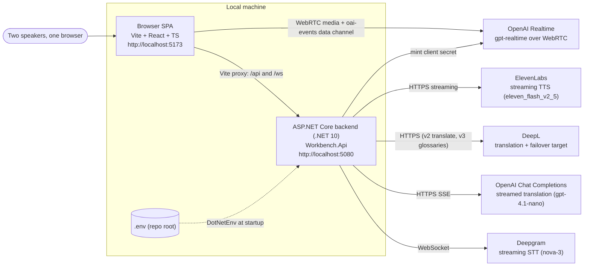
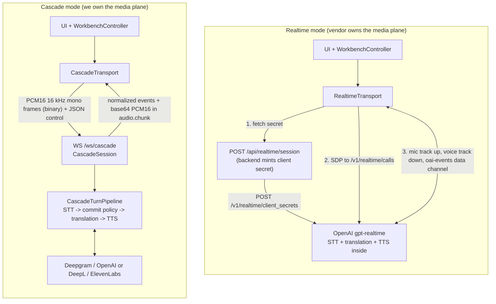
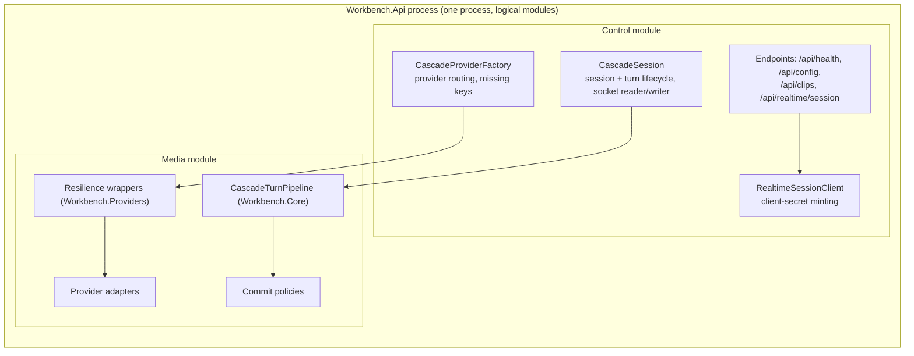

# High-level architecture (as built)

Source: as built at commit fdc469c (code last changed in 7e168f9).

This page describes what the code does today. The pre-build target is [../architecture.md](../architecture.md). Detail lives in [lla.md](lla.md) (modules, contracts, state machines) and [sequences.md](sequences.md) (message flows). Measured results are in [../comparison.md](../comparison.md).

## 1. System context

| Element | Role |
|---|---|
| Browser SPA (`client/`) | Mic capture, push-to-talk floor control, playback, transcripts, latency panel. Measures perceived latency on `performance.now()`. |
| Backend (`server/`) | One process. Serves `/api/*` and `/ws/cascade`. Runs the cascade pipeline and mints Realtime client secrets. |
| Vite dev server | Serves the SPA on 5173 and proxies `/api` and `/ws` to 5080 (`client/vite.config.ts`). |
| Deepgram, OpenAI, ElevenLabs, DeepL | External providers. Only the backend holds their keys. |

## 2. Two paths, side by side

| | Realtime | Cascade |
|---|---|---|
| Transport | WebRTC, browser direct to OpenAI | WebSocket to our backend |
| Backend role | Mint a short-lived client secret (TTL 600 s) with per-direction instructions | Run the whole pipeline per turn |
| Uplink audio | Gated mic `MediaStreamTrack` | PCM16 16 kHz mono, 20 ms frames |
| Downlink audio | Remote WebRTC track, played by an `<audio>` element | `audio.chunk` events (PCM16, 24 kHz from ElevenLabs) into a playback worklet |
| Turn control | Data channel: `session.update`, `input_audio_buffer.commit`, `response.create` | JSON: `turn.start`, `turn.release`, `turn.cancel` |
| Internal stages | Not observable, shown as "hidden" | `stage.timing` per stage |

Both transports implement one `InterpreterTransport` interface and feed the same normalized events to the UI (see [lla.md](lla.md#3-contracts)).

## 3. Control plane vs media plane

| Plane | Cascade mode | Realtime mode |
|---|---|---|
| Control | Ours: `CascadeSession` (configure, warm-up, turn start/release/cancel), `CascadeProviderFactory` (which provider, which keys), `/api/health` and `/api/config`. Floor control is in the browser. | Ours, thin: `POST /api/realtime/session` mints the secret. The browser drives turns over the data channel. |
| Media | Ours: `CascadeTurnPipeline` with Deepgram, OpenAI or DeepL, ElevenLabs behind interfaces. Every stage is timed and swappable. | OpenAI's. Audio goes browser to OpenAI and back; the backend never sees it. |

- The split is logical (folders and projects), not physical. This is planning decision D-04 in [../decisions.md](../decisions.md): one endpoint, both speakers in one browser, and in Realtime mode our media server would sit idle.
- Production path: split the control module (sessions, routing, secrets) and the media module (pipeline workers) into separate services, so media scales with concurrent turns and control stays light.

## 4. Deployment

- Local only. `npm run dev` starts the backend (`dotnet run`, launch profile `http`, port 5080) and Vite (port 5173, `strictPort`) together via `concurrently`.
- The SPA calls relative `/api/...` and `ws://<host>/ws/cascade`, so it only works through the Vite proxy (or same origin).
- The backend also serves cached evaluation clips from `harness/clips/` and `e2e/fixtures/` (`/api/clips`) for the Replay input.
- No containers, no cloud resources.

## 5. Secrets

- `DotEnvLoader.Load()` runs first in `Program.cs`, before `WebApplication.CreateBuilder`. It walks up from the app folder to find `.env` and loads it with DotNetEnv `NoClobber`, so real environment variables win.
- Keys bind through the usual double-underscore names: `OpenAI__ApiKey`, `Deepgram__ApiKey`, `ElevenLabs__ApiKey`, `DeepL__ApiKey`.
- The OpenAI key never reaches the browser: Realtime uses the minted client secret only.
- `/api/health` returns missing variable names (never values), split by mode. The UI shows the `config_error` panel naming them. DeepL is optional: without it the cascade simply has no failover.

## 6. Translation controls

- Formal register plus a clinic glossary, configured in `appsettings.json` under `TranslationControls` (on by default, glossary per direction such as `en-es`).
- Applied in both modes: DeepL via `formality=prefer_more` and a v3 multilingual glossary; the OpenAI translator and the Realtime session via prompt instructions (`InterpreterPrompt.Controls`).
- The header "Clinic terms" toggle (or `?controls=on|off`) sets it per session. Changing it re-warms the transport, because both modes fix it at session setup. Each turn card shows a "Clinic terms on/off" tag.
- Full write-up: [../translation-controls.md](../translation-controls.md).

## Related

- [lla.md](lla.md): modules, interfaces, DI, channels, resilience, events, errors, state machines, timing marks.
- [sequences.md](sequences.md): per-mode message sequences.
- [../comparison.md](../comparison.md): measured comparison and recommendation.
