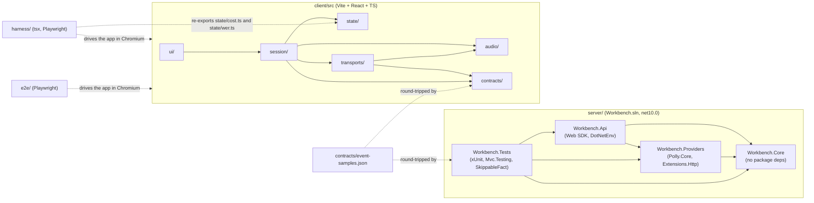
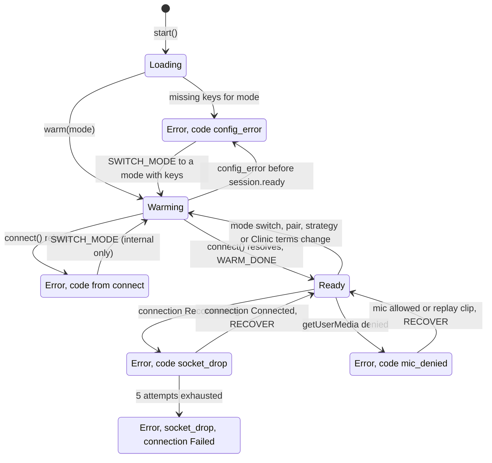
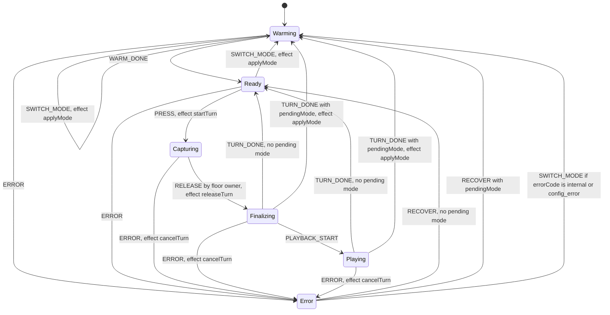
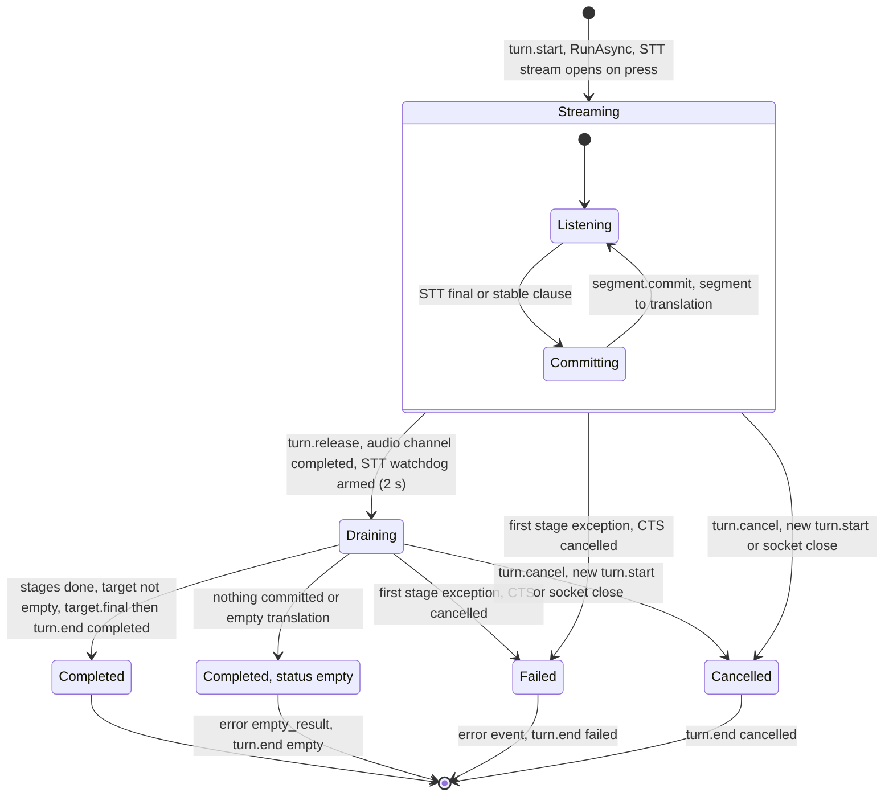
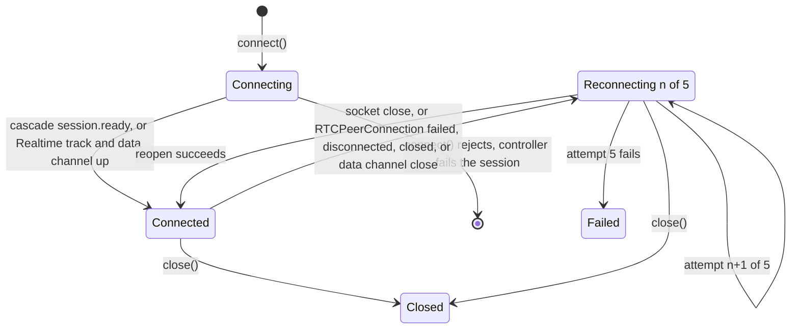
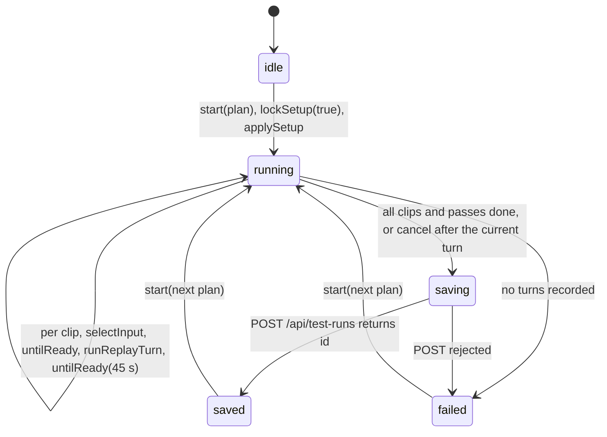

# Low-level architecture (as built)

Source: as built at commit 1e3f900 (code last changed there).

Companion to [hla.md](hla.md). Message flows are in [sequences.md](sequences.md). The pre-build spec is [../architecture.md](../architecture.md); where the code differs, a "Differs from the pre-build spec" note says so.

## 1. Module and project map



### Server: file -> responsibility

| File | Responsibility |
|---|---|
| `server/src/Workbench.Api/Program.cs` | Loads `.env`, binds options, registers HttpClients, adapters, factory, policies; registers providers by name; maps endpoints; WebSockets with 15 s keep-alive. |
| `server/src/Workbench.Api/Config/DotEnvLoader.cs` | Finds `.env` walking up, loads with `NoClobber`. Skipped when `WORKBENCH_SKIP_DOTENV=1`. |
| `server/src/Workbench.Api/Config/RequiredKeys.cs` | Missing key variable names (from the factory key table). |
| `server/src/Workbench.Api/Config/WorkbenchOptions.cs` | `ProvidersOptions`, `CascadeOptions`. |
| `server/src/Workbench.Api/Config/RepoPaths.cs` | Repo root (folder holding `PROGRESS.md`) and clip folders. |
| `server/src/Workbench.Api/Config/BuildInfo.cs` | `BuildInfo.Sha`: short git sha from the assembly informational version (`1.0.0+<sha>`), `unknown` if absent. No git call at runtime; uncommitted changes are not detected. |
| `server/src/Workbench.Api/Control/CascadeSession.cs` | One cascade session per WebSocket: reader loop, single writer loop, configure, warm-up, keep-warm, turn lifecycle. |
| `server/src/Workbench.Api/Control/CascadeProviderFactory.cs` | Provider registry by name, per-session resolution, missing and unknown provider checks, resilience wrapping. |
| `server/src/Workbench.Api/Endpoints/HealthEndpoints.cs` | `GET /api/health` (build sha, missing keys by mode), `GET /api/config` (pairs, languages, providers, controls default). |
| `server/src/Workbench.Api/Endpoints/RealtimeEndpoints.cs` | `POST /api/realtime/session`: mints the client secret, returns per-direction instructions, maps provider errors to typed bodies. |
| `server/src/Workbench.Api/Endpoints/CascadeEndpoints.cs` | `/ws/cascade`: accepts the socket, creates a `CascadeSession`. |
| `server/src/Workbench.Api/Endpoints/ClipEndpoints.cs` | `GET /api/clips` (id, lang, text, target and reference from `harness/scripts.json`, `durationSeconds` from the WAV header), `GET /api/clips/{id}.wav` for the Replay input and Test Runs. |
| `server/src/Workbench.Api/Endpoints/TestRunEndpoints.cs` | `GET /api/test-runs`, `GET /api/test-runs/{id}`, `POST /api/test-runs`: one JSON file per run in `TestRuns:Directory` (default `harness/results/test-runs/`). |
| `server/src/Workbench.Api/appsettings.json` | `Cascade`, `Providers`, `Languages`, `TranslationControls` sections. |
| `server/src/Workbench.Core/Contracts/Providers.cs` | `ISttProvider`, `ITranslationProvider`, `ITtsProvider`, `ICommitPolicy`, `IWarmable`, records, `TurnMeter`. |
| `server/src/Workbench.Core/Commit/CommitPolicies.cs` | `SegmentCommitPolicy`, `ClauseCommitPolicy`, `ICommitPolicyFactory`. |
| `server/src/Workbench.Core/Pipeline/CascadeTurnPipeline.cs` | One cascade turn: three stage tasks over bounded channels, per-turn cancellation, stage timings, terminal events. |
| `server/src/Workbench.Core/Events/WorkbenchEvents.cs` | Normalized event records, polymorphic JSON on `type`. |
| `server/src/Workbench.Core/Errors.cs` | Error codes and `ProviderException` hierarchy. |
| `server/src/Workbench.Core/Languages.cs` | `LanguagesOptions` (languages, pairs, provider language codes). |
| `server/src/Workbench.Core/TranslationControlsOptions.cs` | Formal + glossary per direction, `For(source, target, enabled)`. |
| `server/src/Workbench.Providers/Deepgram/DeepgramSttProvider.cs` | Streaming STT over WebSocket, Finalize on release, KeepAlive, connect retry. |
| `server/src/Workbench.Providers/OpenAI/OpenAITranslationProvider.cs` | Streamed Chat Completions translation (SSE). |
| `server/src/Workbench.Providers/OpenAI/RealtimeSessionClient.cs` | Mints Realtime client secrets (`/v1/realtime/client_secrets`). |
| `server/src/Workbench.Providers/OpenAI/OpenAIOptions.cs` | OpenAI options and `InterpreterPrompt` (shared by both modes). |
| `server/src/Workbench.Providers/DeepL/DeepLTranslationProvider.cs` | DeepL v2 translate, `formality`, v3 glossary find-or-create. |
| `server/src/Workbench.Providers/ElevenLabs/ElevenLabsTtsProvider.cs` | ElevenLabs HTTP streaming TTS, PCM 24 kHz. |
| `server/src/Workbench.Providers/Fakes/FakeProviders.cs` | Fake STT, translation, TTS with fault injection (`429`, `429x3`, `timeout`, `empty`, `error`, `400`). |
| `server/src/Workbench.Providers/Resilience/*.cs` | Retry pipelines, first-item and idle timeouts, failover circuit. |
| `server/tests/Workbench.Tests/` | Commit policy, pipeline, provider contract, controls, factory, socket, health, Realtime endpoint, event contract tests. |

### Client and tooling: file -> responsibility

| File | Responsibility |
|---|---|
| `client/src/App.tsx` | Reads URL params (`mode`, `strategy`, `providers`, `controls`), creates one `WorkbenchController` and one `TestRunner`, lays out three tabs (Workbench, Test Runs, Documentation; open tab kept in the URL hash). |
| `client/src/api.ts` | `GET /api/health`, `/api/config`, `/api/clips`, `/api/test-runs`, `/api/test-runs/{id}`; `saveTestRun` (POST). `SavedTestRun` type. |
| `client/src/session/controller.ts` | `WorkbenchController`: mode-agnostic session layer; owns audio engine, turn machine, metrics, active transport. Test Run hooks: `applySetup`, `lockSetup`, `untilReady`, `runId`. |
| `client/src/session/TestRunner.ts` | Runs one Test Run plan on the controller (setup, clips, passes), collects turns, saves the run. Lives outside React. |
| `client/src/session/testRun.ts` | Pure: `SETUPS` (four configurations), `estimate`, `summarizeRun`, `compareRuns`. |
| `client/src/state/turnMachine.ts` | Pure turn/floor reducer `(state, action) -> { state, effects }`. |
| `client/src/state/metrics.ts` | Per-turn marks, stage durations, run conditions, p50/p95, export. |
| `client/src/state/cost.ts` | `turnCost(usage, pricing, translation)`: USD per turn from `harness/pricing.json`. Shared with the harness. |
| `client/src/state/wer.ts` | `normalize`, `wer`. Shared with the harness. |
| `client/src/transports/types.ts` | `InterpreterTransport`, `TransportSink`, `ConnectionState`. |
| `client/src/transports/factory.ts` | Picks the transport per mode; `?transport=fake`, `?faults=`. |
| `client/src/transports/cascade/CascadeTransport.ts` | WebSocket transport, reconnect 1-5, consecutive playback. |
| `client/src/transports/realtime/RealtimeTransport.ts` | WebRTC transport, data channel, response-start timeout, reconnect 1-5. |
| `client/src/transports/realtime/eventMapper.ts` | Maps OpenAI Realtime server events to normalized events and marks; prunes context to 2 turns. |
| `client/src/transports/realtime/rtcStats.ts` | `readInboundAudio` (inbound-rtp audio counters from `getStats()`), `playbackStatsBetween` (jitter-buffer ms, concealed %, packets lost over an interval). |
| `client/src/transports/fake/FakeTransport.ts` | Client-only simulator, no backend. |
| `client/src/audio/captureEngine.ts` | Mic or replay clip into the capture worklet, PTT gate, `MicDeniedError`. |
| `client/src/audio/energyDetector.ts` | Speech start and speech end (T0): -45 dBFS, 2 start frames, 300 ms hangover. |
| `client/src/audio/player.ts` + `worklets/playback.worklet.ts` | Jitter buffer plus OutputTap that posts `first_audible`. |
| `client/src/audio/remoteTap.ts` | AnalyserNode on the remote WebRTC track: first audible (peak 0.01), silence after 700 ms. |
| `client/src/audio/denyTone.ts` | Two-note deny tone straight to `ctx.destination`, never through the OutputTap. |
| `client/src/contracts/events.ts` | TS mirror of the event schema, `parseEvent` validation. |
| `client/src/ui/*.tsx` | Header (mode, strategy, pair, input, Clinic terms; locked during a Test Run), speaker stage, talk buttons, transcripts (4 cards visible, the rest scroll), latency panel, banners, config panel. |
| `client/src/ui/ModeComparison.tsx` | Latest turn per mode side by side (latency, input, cost); replaced the single "Last turn" card. |
| `client/src/ui/TestRuns.tsx` | Test Runs tab: plan form with estimate (rates from `harness/results/cost-per-minute.json`), progress and cancel, saved list, detail, compare two runs. |
| `client/src/ui/Documentation.tsx` | Documentation tab: static how-to for testers. |
| `contracts/event-samples.json` | Sample events round-tripped by both sides' contract tests. |
| `harness/*.ts` | Clip generation, four-configuration runs, soak, onboarding, report, controls report. `metrics.ts` re-exports `wer` and `turnCost` from the client. `report.ts` also writes `harness/results/cost-per-minute.json` and has human spot-check and live-voice sections. |
| `e2e/*.spec.ts` | Playwright: audio engine, cascade with fakes and real providers, Realtime, error states, mic denied, UI walkthrough. |

## 2. Contracts

```mermaid
classDiagram
    class InterpreterTransport {
        <<interface>>
        +Mode mode
        +string kind
        +connect() Promise~void~
        +startTurn(TurnSpec turn) void
        +sendFrame(string turnId, Int16Array pcm) void
        +release(string turnId) void
        +cancel(string turnId) void
        +close() Promise~void~
        +diagnostics() Record
        +resumeAudio() void
    }
    class TransportSink {
        <<interface>>
        +event(WorkbenchEvent e, number receivedAt) void
        +connection(ConnectionState state, number attempt, number maxAttempts) void
        +mark(string turnId, MarkName name, number perfMs) void
        +playbackStarted(string turnId) void
        +playbackEnded(string turnId) void
        +playbackStats(string turnId, PlaybackStats stats) void
    }
    class RealtimeTransport {
        +kind WebRTC
    }
    class CascadeTransport {
        +kind WebSocket
    }
    class FakeTransport {
        +kind Simulated
    }
    InterpreterTransport <|.. RealtimeTransport
    InterpreterTransport <|.. CascadeTransport
    InterpreterTransport <|.. FakeTransport
    InterpreterTransport ..> TransportSink : reports to

    class ISttProvider {
        <<interface>>
        +Name string
        +TranscribeAsync(ChannelReader~AudioFrame~, SttOptions, CancellationToken) IAsyncEnumerable~SttResult~
    }
    class ITranslationProvider {
        <<interface>>
        +Name string
        +TranslateAsync(Segment, TranslationContext, CancellationToken) IAsyncEnumerable~string~
    }
    class ITtsProvider {
        <<interface>>
        +Name string
        +SynthesizeAsync(string, VoiceOptions, CancellationToken) IAsyncEnumerable~AudioChunk~
    }
    class ICommitPolicy {
        <<interface>>
        +Name string
        +Accept(SttResult) IReadOnlyList~Segment~
        +Flush() IReadOnlyList~Segment~
    }
    class ICommitPolicyFactory {
        <<interface>>
        +Names IReadOnlyList~string~
        +Create(string name) ICommitPolicy
    }
    class IWarmable {
        <<interface>>
        +WarmUpAsync(CancellationToken) Task
    }
    ISttProvider <|.. DeepgramSttProvider
    ISttProvider <|.. FakeSttProvider
    ITranslationProvider <|.. OpenAITranslationProvider
    ITranslationProvider <|.. DeepLTranslationProvider
    ITranslationProvider <|.. FakeTranslationProvider
    ITranslationProvider <|.. ResilientTranslationProvider
    ITtsProvider <|.. ElevenLabsTtsProvider
    ITtsProvider <|.. FakeTtsProvider
    ITtsProvider <|.. ResilientTtsProvider
    ICommitPolicy <|.. SegmentCommitPolicy
    ICommitPolicy <|.. ClauseCommitPolicy
    ICommitPolicyFactory <|.. CommitPolicyFactory
    ICommitPolicyFactory ..> ICommitPolicy : creates per turn
```



Key records (`Workbench.Core/Contracts/Providers.cs`):

```csharp
public readonly record struct AudioFrame(ReadOnlyMemory<byte> Pcm16);              // 20 ms, 640 bytes
public readonly record struct AudioChunk(ReadOnlyMemory<byte> Pcm16, int SampleRate);
public sealed record SttResult(string Text, bool IsFinal, bool FromFinalize = false);
public sealed record Segment(int Index, string Text);
public sealed record TranslationContext(string SourceLang, string TargetLang,
    IReadOnlyList<(string Source, string Target)> Previous, TurnMeter? Meter = null, TranslationControls? Controls = null);
```

- In TypeScript, `resumeAudio?()` is optional (only `RealtimeTransport` implements it) and `connection()` takes `attempt` and `maxAttempts` as optional. The UI sees only `TransportSink` signals and normalized events.
- `TransportSink.playbackStats?()` is optional and Realtime only. `RealtimeTransport` snapshots the `getStats()` inbound audio counters at release and again after playback ends, and reports the difference (`jitterBufferMs`, `concealedPct`, `packetsLost`). It may arrive after `playbackEnded`; the controller stores it as `TurnRecord.playback`. The transport also samples every 2 s for `diagnostics()` (`rtJitterBufferMs`, `rtConcealedSamples`, `rtTotalSamples`, `rtPacketsLost`, cumulative since the peer connection opened).
- `RunConditions` gained `runId` (8 hex chars, one per page session, `controller.runId`) and `build` (from `/api/health`). Both are absent in runs recorded before them. `TurnRecord` gained `playback?`.
- `IWarmable` is implemented by Deepgram, OpenAI translation, DeepL and ElevenLabs. Deepgram warm-up resolves DNS and checks the key over REST; its STT socket opens per turn on press.
- `TurnMeter` collects per-turn usage and records which translator served and the first failover.
- Commit policies are pure (no I/O, no clocks) and created fresh per turn. `segment` commits each STT final (dropping empty finals and a finalize duplicate); `clause` commits stable interim prefixes at `, ; : . ? !` or before a conjunction, min 3 words unless the clause ends in `. ? !`.

## 3. DI and configuration selection

**Registrations in `Program.cs`**

| Registration | Kind |
|---|---|
| `ProvidersOptions` <- `Providers`, `LanguagesOptions` <- `Languages`, `CascadeOptions` <- `Cascade`, `TranslationControlsOptions` <- `TranslationControls`, `ResilienceOptions` <- `Resilience`, `OpenAIOptions` <- `OpenAI`, `DeepgramOptions` <- `Deepgram`, `DeepLOptions` <- `DeepL`, `ElevenLabsOptions` <- `ElevenLabs` | `Configure<T>` |
| HttpClients: `openai` (typed `RealtimeSessionClient`, 30 s), `deepgram` (15 s), `deepl` (15 s), `elevenlabs` (60 s) | `SocketsHttpHandler`, idle 5 min, lifetime 15 min, handler never rotated |
| `DeepgramSttProvider`, `OpenAITranslationProvider`, `DeepLTranslationProvider`, `ElevenLabsTtsProvider` | Singletons |
| `TimeProvider.System`, `FailoverCircuitRegistry`, `CascadeProviderFactory` | Singletons |
| `ICommitPolicyFactory` -> `CommitPolicyFactory` | Singleton |
| `CascadeSession` | Created per socket with `ActivatorUtilities` |

After `Build()`, providers register by name: `AddStt("deepgram")`, `AddTranslation("openai")`, `AddTranslation("deepl")`, `AddTts("elevenlabs")`. Fakes are built in: `fake` for each stage and `fake-deepl` for translation.

**appsettings.json sections**

| Section | Content |
|---|---|
| `Cascade` | `DefaultStrategy: "segment"` |
| `Providers` | `Stt: deepgram`, `Translation: openai`, `TranslationFallback: deepl`, `Tts: elevenlabs` |
| `Languages` | `en`, `es`, `fr` with Deepgram and DeepL codes; pairs `en-es` (default) and `en-fr` |
| `TranslationControls` | `Enabled: true`, `Formal: true`, `Glossary` for `en-es` and `es-en` |

There is no `Resilience`, `OpenAI`, `Deepgram`, `DeepL` or `ElevenLabs` section in `appsettings.json`; those options use their code defaults plus the `.env` keys. Model defaults: Deepgram `nova-3` (endpointing 300 ms), OpenAI translation `gpt-4.1-nano`, Realtime `gpt-realtime` with voice `marin` and transcription `gpt-4o-transcribe`, ElevenLabs `eleven_flash_v2_5`, DeepL `model_type=latency_optimized`.

**Per-session selection (`CascadeProviderFactory`)**

1. The URL `?providers=` is parsed in `App.tsx` (`fake` = all fakes, or `translation:deepl,tts:elevenlabs`). The client sends it in `session.configure.providers`.
2. `Resolve(sel)`: each unset field falls back to the `Providers` section. A `fake` primary gets `fake-deepl` as fallback. A fallback equal to the primary becomes `none`.
3. `MissingKeys(names)`: variable names for STT, translation and TTS only. The fallback is optional; `UsableFallback` turns it into `none` when its key is missing.
4. `UnknownProviders(names)`: any name not registered -> `config_error`.
5. `Create(names, faults)`: builds the adapters, wraps translation in `ResilientTranslationProvider` (with fallback and circuit) and TTS in `ResilientTtsProvider`. STT is not wrapped. Real primaries share one `FailoverCircuit` per provider name across sessions; fakes get a fresh circuit per session.
6. `?faults=translation:429,tts:timeout` is passed through for fakes only.

`/api/health` uses the same factory: `missingByMode.realtime` is `OpenAI__ApiKey` only, `missingByMode.cascade` is `MissingKeys` for the default cascade set.

## 4. Channels and cancellation

```mermaid
flowchart LR
    rd["CascadeSession reader loop<br/>(socket receive)"]
    a[["audio channel<br/>bounded 1500 frames = 30 s<br/>FullMode Wait"]]
    stt["STT stage<br/>RunSttAsync"]
    s[["segments channel<br/>bounded 32"]]
    tr["Translation stage<br/>RunTranslationAsync"]
    sp[["toSpeak channel<br/>bounded 32"]]
    tts["TTS stage<br/>RunTtsAsync"]
    out[["outgoing event channel<br/>bounded 4096, single reader"]]
    wr["CascadeSession writer loop<br/>(only socket writer)"]
    rd -- "binary frames" --> a
    a --> stt
    stt -- "commit policy" --> s
    s --> tr
    tr --> sp
    sp --> tts
    stt -. "IEventSink.EmitAsync" .-> out
    tr -. "IEventSink.EmitAsync" .-> out
    tts -. "IEventSink.EmitAsync" .-> out
    out --> wr
```



- **Bounded everywhere.** The reader awaits when the audio channel is full (backpressure). `PipelineOptions`: `AudioCapacityFrames = 1500`, `StageCapacity = 32`, `ContextSegments = 2`, `SttFinalTimeout` from `ResilienceOptions` (2 s).
- **Single writer.** `CascadeSession` implements `IEventSink`; the pipeline never touches the socket. `WriteLoopAsync` is the only code that sends. If the writer dies, the channel is completed and further emits are dropped instead of blocking.
- **Per-turn cancellation.** Each `CascadeTurnPipeline` owns a `CancellationTokenSource` linked to the session token. `Stage()` catches the first real failure, stores it and cancels the CTS, which stops all three stages. `Cancel()` (client `turn.cancel`, a new `turn.start` while a turn runs, or socket close) completes the audio channel and cancels the CTS. Terminal events use `CancellationToken.None` so `error` and `turn.end` still go out after a cancel.
- **STT watchdog.** Armed at release; if STT has not finished within `SttFinalTimeout`, the STT stream is cancelled and the turn carries on with `Flush()`. Only if nothing was committed does it raise `provider_timeout`.
- **Session cleanup.** `RunAsync` `finally`: cancel session CTS, cancel the turn, complete the outgoing channel, then await the turn, writer and keep-warm tasks independently.
- **Warm-up.** On `session.configure`, `WarmAsync` calls every `IWarmable` with a 5 s timeout (best effort), then emits `session.ready`. A keep-warm loop re-warms after 45 s idle (checked every 5 s).

## 5. Resilience

**Server (`Workbench.Providers/Resilience`, defaults from `ResilienceOptions`)**

| Mechanism | Applies to | Value |
|---|---|---|
| First-item timeout (`StartedStream.StartAsync`) | Translation first token, TTS first byte | 2 s each |
| Timeout retry (Polly outer retry, no delay) | Translation, TTS | 1 retry, then `provider_timeout` |
| Retry on 429 and transient errors (Polly inner retry) | Translation, TTS, before the first item only | max 3, exponential, base 200 ms, jitter on |
| Stream idle timeout (stall after first item) | Translation, TTS | 5 s -> `provider_timeout` |
| Failover circuit (`FailoverCircuit`) | Translation | Trips when 429 survives all retries; open 60 s; while open, calls go straight to the fallback (DeepL). Reported once per turn as `provider.failover`. |
| STT final timeout | STT, after release | 2 s, no retry |
| Deepgram connect | STT | 3 s connect timeout, 2 retries on 429, 5xx or network, delay `150 x (n+1)` ms + 0-100 ms jitter |
| Deepgram finalize quiet timeout | STT, after release | 1500 ms without messages ends the stream |
| Deepgram KeepAlive | STT, during a turn | Sent after 4 s without audio |
| DeepL `model_type` fallback | DeepL | On 400 mentioning `model_type`, retry once without it. 456 (quota) is not retryable. |

Transient = `ProviderErrorException` with no status, 408, 425 or 5xx.

**Client**

| Mechanism | Where | Value |
|---|---|---|
| Realtime response-start timeout | `RealtimeTransport.release` | 5 s without `response.created` -> `error provider_timeout` + `turn.end failed` |
| Realtime connect waits | `RealtimeTransport.open` | 10 s for the remote track, 10 s for the data channel -> `socket_drop` |
| Cascade warm-up timeout | `CascadeTransport.open` | 15 s without `session.ready` -> `provider_timeout` |
| Reconnect | Both transports | 5 attempts, backoff `min(4000, 500 x 2^(n-1))` ms = 0.5, 1, 2, 4, 4 s |
| Turn safety net | `controller.completeRelease` | 30 s after release -> turn fails with `internal` |

> **Differs from the pre-build spec:** §6 asked for one retry on STT final timeout. The code does not retry (no audio left to resend after release) and instead commits what was heard. There is no `Resilience` section in `appsettings.json`; values are code defaults (still bindable).

## 6. Event schema

All events carry `type`, `t` (ms on the emitter's monotonic clock) and optional `turnId`. Server: `WorkbenchEvents.cs` (System.Text.Json web casing, nulls omitted). Client: `events.ts` with `REQUIRED_FIELDS` validation.

| type | Fields | Emitted by |
|---|---|---|
| `session.ready` | `mode`, `providers {stt, translation, translationFallback, tts}`, `strategy` | `CascadeSession` after warm-up; synthesized by `RealtimeTransport` and `FakeTransport` |
| `turn.start` | `speaker`, `direction` | Pipeline start; `RealtimeTransport.startTurn` |
| `source.partial` | `text`, `lang`, `stable` | Pipeline (STT interim); Realtime mapper (transcription delta) |
| `source.final` | `text`, `lang` | Pipeline (each STT final, cumulative); Realtime mapper |
| `segment.commit` | `segment`, `text` | Pipeline, per commit-policy decision (cascade only) |
| `target.partial` | `text`, `lang` (cumulative) | Pipeline per translation delta; Realtime mapper |
| `target.final` | `text`, `lang` | Pipeline on completion; Realtime mapper |
| `audio.chunk` | `data` (base64 PCM16 LE mono), `sampleRate`, `segment` | Pipeline TTS stage (cascade only) |
| `stage.timing` | `stage` (`stt_final`, `translate_first_token`, `translate_done`, `tts_first_byte`), `durationMs`, `segment`, `provider` | Pipeline (Stopwatch) |
| `provider.failover` | `stage`, `from`, `to`, `reason` | `TurnMeter.ReportFailover` via the pipeline |
| `turn.end` | `speaker`, `direction`, `status` (`completed`, `empty`, `cancelled`, `failed`), `usage?`, `providersUsed?`, `failoverNote?` | Pipeline `FinishAsync`; `CascadeSession` on crash; Realtime mapper / transport |
| `floor.denied` | `speaker` | Defined in both schemas; never sent on the wire. Floor deny is browser-only and logged with `console.info`. |
| `error` | `code`, `message`, `retryable`, `provider?`, `stage?`, `httpStatus?` | Pipeline, `CascadeSession`, Realtime mapper / transport |

`TurnUsage` = `sttAudioSeconds`, `translationInputTokens`, `translationOutputTokens`, `translationCharacters`, `ttsCharacters`, optional `realtime` token counts.

Client to server (cascade only, JSON text frames): `session.configure {pairId, strategy, providers?, faults?, controls?}`, `turn.start {turnId, speaker, source, target}`, `turn.release {turnId}`, `turn.cancel {turnId}`, `ping`. Binary frames are PCM16 audio for the active turn.

> **Differs from the pre-build spec:** `segment.commit` and `provider.failover` were added during the build. `stage.timing` gained `segment` and `provider`; `source.partial` gained `stable`; `audio.chunk` gained `segment` and carries `sampleRate` rather than a fixed 24 kHz; `turn.end` gained `status`, `usage`, `providersUsed`, `failoverNote`; `error` gained `stage` and `httpStatus`. `speaker` is the source language code, as specified.

## 7. Error taxonomy

| Code | Raised where | UI |
|---|---|---|
| `mic_denied` | Client only: `CaptureEngine` throws `MicDeniedError` on `NotAllowedError`, `SecurityError` or `NotFoundError`; `controller.selectInput` sets the session error. | `MicDeniedPanel` (blocking) with "Use replay clips" and "Try again". Phase `Error`. |
| `socket_drop` | Client only: `CascadeTransport` socket close during warm-up; `RealtimeTransport` data channel error or 10 s connect waits; `controller.onConnection` on `Reconnecting` or `Failed`. | `ConnectionBanner`: "Reconnecting, attempt n of 5", then "Connection failed after 5 attempts. Reload to retry." Talk buttons disabled. |
| `provider_timeout` | Server: first-item timeout after 1 retry, 5 s stream stall, STT final timeout with nothing committed, Deepgram connect over 3 s, `RealtimeEndpoints` maps to HTTP 504. Client: Realtime 5 s response start, cascade 15 s warm-up. | Turn: `TurnError` "Timed out at {stage}" + "Retry turn". Session (warm-up): `SessionErrorBanner` "Provider timed out". |
| `rate_limited` | Server: adapters throw `RateLimitedException` on 429 (Deepgram connect, OpenAI, DeepL, ElevenLabs, client-secret mint -> HTTP 429). Client: Realtime `rate_limit_exceeded`, SDP exchange 429. | Turn: `TurnError` "Provider error at {stage}" + retry. Session: `SessionErrorBanner` "Provider busy". Failover instead: toast "Translation provider busy ... Switched to DeepL". |
| `empty_result` | Server: `FinishAsync` when nothing was committed or the translation is empty. Client: Realtime `input_audio_buffer_commit_empty`. | Turn card note "No speech detected. Hold the button while you talk." Turn status `empty`. |
| `config_error` | Server: `session.configure` with missing keys or unknown providers, `turn.start` before configure, `ProviderConfigException` in adapters, mint -> HTTP 503. Client: `missingKeysFor(mode)` from `/api/health` before warm-up. | `ConfigErrorPanel` listing variable names from `health.missingByMode[mode]` and pointing to `.env`. Escapable by switching mode. |
| `provider_error` | Server: `ProviderErrorException` (non-429 HTTP, auth, stream error codes), mint -> HTTP 502. Client: Realtime default mapping, SDP non-429 failure, mint failure without a code. | Turn: `TurnError` "Provider error at {stage} (HTTP n)" + retry. Session: `SessionErrorBanner` "Could not start the session". |
| `internal` | Server: unexpected pipeline exception, malformed or unknown control message, reconfigure during a turn, missing `turn.start` fields. Client: 30 s turn safety net, unknown warm-up failure codes. | Turn: `TurnError` "Something went wrong (turn id)" (no retry). Session: `SessionErrorBanner`. Turn-less server error: toast "Error". |

Classification in `controller.onEvent`: `socket_drop`, `config_error`, `mic_denied` are session-level (`failSession` -> phase `Error`); other codes with a `turnId` mark the turn `failed` (or `empty`) and the turn ends normally on `turn.end`.

## 8. State machines

### (a) Session, as the controller models it

There is no separate session machine. Session state is the turn phase plus `sessionError.code` plus the transport `connection.state` in `controller.ts`.



> **Differs from the pre-build spec:** §4 listed `Idle -> Warming -> Ready -> Closed` plus `Error` as its own machine. The build folds it into the turn machine's `Warming`, `Ready` and `Error` phases; "Closed" exists only as a transport `ConnectionState`.

### (b) Turn and floor (`client/src/state/turnMachine.ts`)



Transitions that do not change the phase:

| Phase | Action | Result |
|---|---|---|
| Capturing | PRESS by the same speaker | Ignored (key repeat) |
| Capturing, Finalizing, Playing | PRESS by anyone else | Effect `floorDenied`: deny tone, shake, "Floor busy" for 1.4 s. No queuing. |
| Warming, Error | PRESS | Effect `notReady` flash |
| Capturing, Finalizing, Playing | SWITCH_MODE to another mode | `pendingMode` set, effect `switchQueued`; banner offers "Stay on ..." |
| Error (other codes) | SWITCH_MODE | Queued as `pendingMode` |
| Any | SWITCH_MODE to the current mode, or CANCEL_SWITCH | `pendingMode` cleared |
| Any but Capturing by owner | RELEASE | Ignored |

`TURN_DONE` fires when both `turn.end` arrived and `playbackEnded` fired (`maybeFinish`), or from the 30 s safety net.

### (c) Cascade turn pipeline (server, per turn)



Translation and TTS run concurrently with STT the whole time: each committed segment is translated (streamed, last 2 segments as context) and then synthesized, so `audio.chunk` events arrive during speech. The client buffers them and starts playback on release (consecutive playback). The final state is set in `FinishAsync` after all three stage tasks end; the enum is `TurnPipelineState { Streaming, Draining, Completed, Cancelled, Failed }`.

### (d) Transport connection (`ConnectionState` in `transports/types.ts`)



On a reconnect the cascade transport drops the current turn and its audio; the controller cancels the turn via `ERROR socket_drop`. `Closed` is emitted on deliberate close (mode switch, re-warm).

## 9. Test Runs

**Controller API used by Test Runs (`session/controller.ts`)**

| Member | Behaviour |
|---|---|
| `applySetup(setup)` | Only in `Ready`, else rejects. Sets strategy, Clinic terms and provider overrides (an all-fake session stays all-fake); switches mode or re-warms if anything changed; resolves when `Ready`. |
| `lockSetup(locked)` | Sets snapshot `setupLocked`, which disables the header's setup controls. |
| `untilReady(timeoutMs = 30000)` | Resolves when the phase is `Ready`; rejects on `Error` or timeout. |
| `runReplayTurn(speaker, buffer?)` | Now resolves with the `turnId` once the clip has played and the turn is released, or `null` if the turn did not start. |
| `runId` | Readonly page-session id, copied into every turn's `RunConditions`. |

**Runner lifecycle (`session/TestRunner.ts`)**



- `cancel()` sets a flag; the runner stops after the turn in progress. An error mid-run also stops it. Either way, the turns recorded so far are saved with status `cancelled` (fewer turns than planned), else `completed`. `lockSetup(false)` runs before saving.
- The saved body holds `name`, `status`, `setup` (key, label, mode, strategy, controls, providers), `clips`, `passes`, `pair`, `build`, `runId`, `summary` (`summarizeRun`: mouth-to-ear p50 and p95 vs the setup target, access and stage p50s, source and target WER, cost per voiced minute) and `turns` (full `TurnRecord`s).

**API**

| Endpoint | Behaviour |
|---|---|
| `GET /api/test-runs` | All runs with `turns` removed, newest first by `createdAt`. Unparseable files are skipped. Empty list if the folder is missing. |
| `GET /api/test-runs/{id}` | The full file. 404 unless `id` matches `^[a-z0-9-]{1,80}$` and the file exists. |
| `POST /api/test-runs` | Validates: body under 10 MB, JSON object, `name` 1 to 200 chars, `setup.mode` is `realtime` or `cascade`, `turns` is an array; else 400 with `error`. Adds `id` (`yyyyMMdd-HHmmssfff-<slug>`) and `createdAt`, writes a temp file, then moves it into place. 201 with `{ id }`. |

The turn and floor machine (section 8b) is unchanged: a Test Run drives it through the same `PRESS` and `RELEASE` actions as the Replay input.

## 10. Timing marks

All marks are browser `performance.now()` values in `MetricsStore` (`client/src/state/metrics.ts`). Marks are first-write-wins except stage marks (latest segment wins).

| Mark | Captured in | How |
|---|---|---|
| `press` | `session/controller.ts` `startTurn` -> `metrics.startTurn(..., now)` | At the PRESS effect, synchronous with the pointer handler |
| `access` | Cascade: `CascadeTransport.sendFrame` (first frame sent on the socket). Realtime: `RealtimeTransport.startTurn` (track already live) | `sink.mark(turnId, "access")` |
| `speechStart` | `controller.onFrame` | `EnergyDetector` `speech_start` |
| `t0` | `controller.completeRelease` | `detector.lastVoicedEnd`, capped at release time. Frames overlapping the deny tone are excluded. |
| `release` | `controller.releaseTurn` | Pointer up; frames in flight are fed for up to 80 ms before finalizing |
| `sttFinal` | Server `CascadeTurnPipeline.RunSttAsync` (duration from release) | Client `metrics.stage`: mark = browser receive time of `stage.timing` |
| `translateFirstToken`, `translateDone` | Server `RunTranslationAsync` (Stopwatch per segment) | Same mapping |
| `ttsFirstByte` | Server `RunTtsAsync` (Stopwatch per segment) | Same mapping |
| `rtResponseStart` | `transports/realtime/eventMapper.ts` on `response.created` | Realtime only |
| `firstAudible` | Cascade: `audio/worklets/playback.worklet.ts` OutputTap -> `Player.onFirstAudible` -> `CascadeTransport`. Realtime: `audio/remoteTap.ts` AnalyserNode (peak >= 0.01, armed on release) -> `RealtimeTransport` | Interpreted audio only; the deny tone bypasses both taps |

Headline: mouth-to-ear = `firstAudible - t0`. Access time = `access - press`. Realtime internal stages are not observable and are shown as hidden. Realtime playback health (`TurnRecord.playback`) is not a mark: it is a `getStats()` difference between release and the end of playback.

## Related

- [hla.md](hla.md): system context, the two paths, control vs media plane.
- [sequences.md](sequences.md): message sequences per mode.
- [../comparison.md](../comparison.md): measured results.
