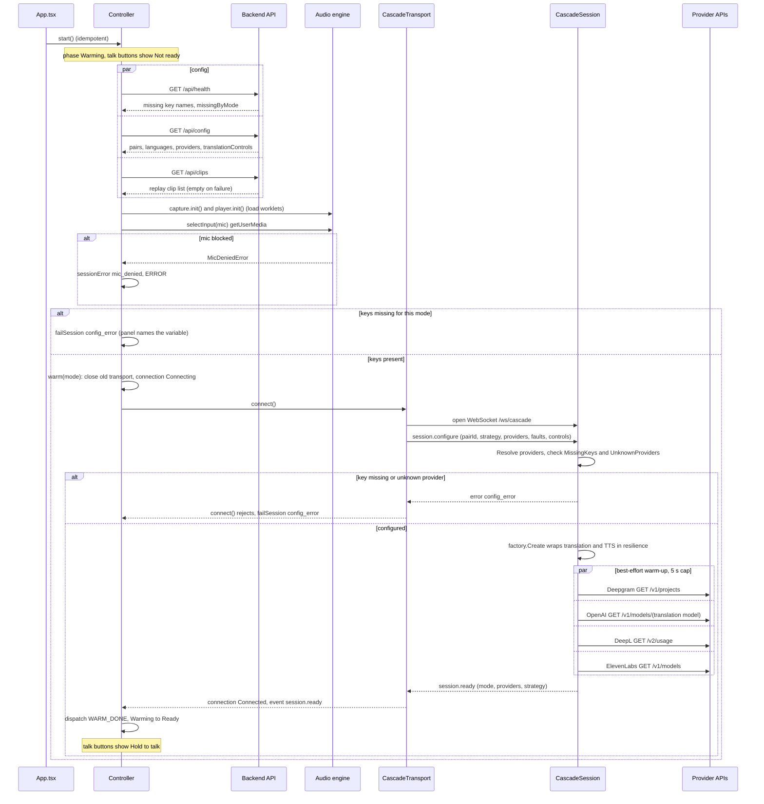
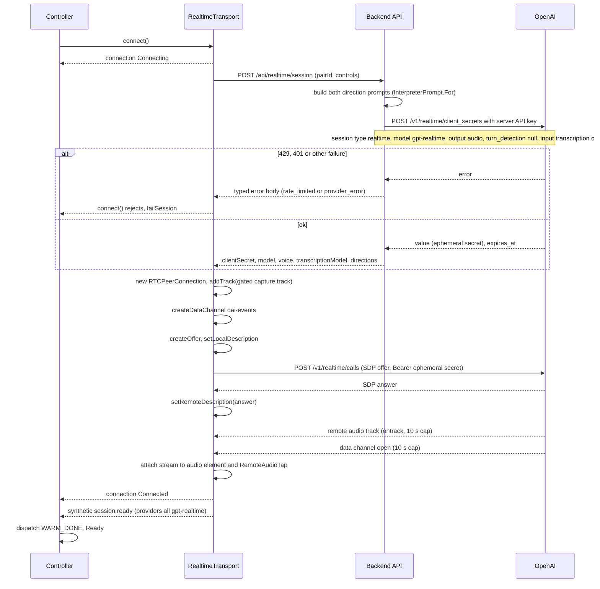
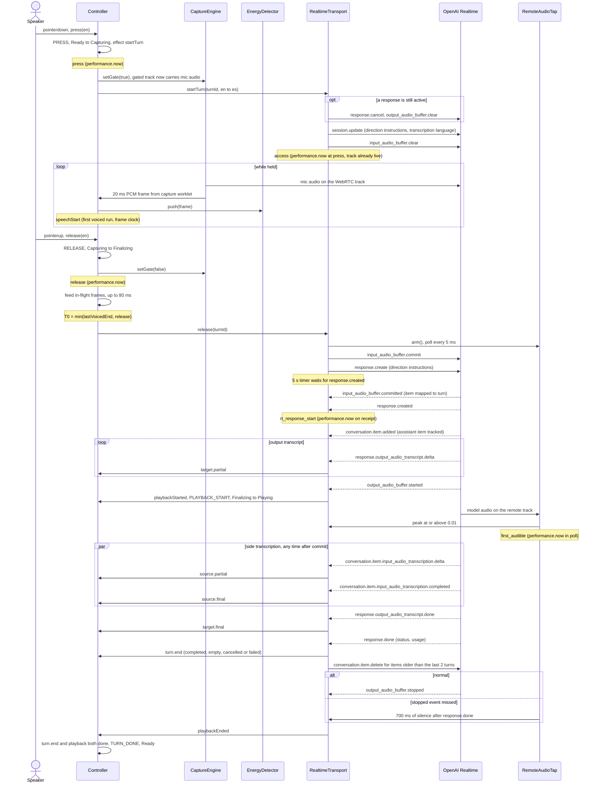
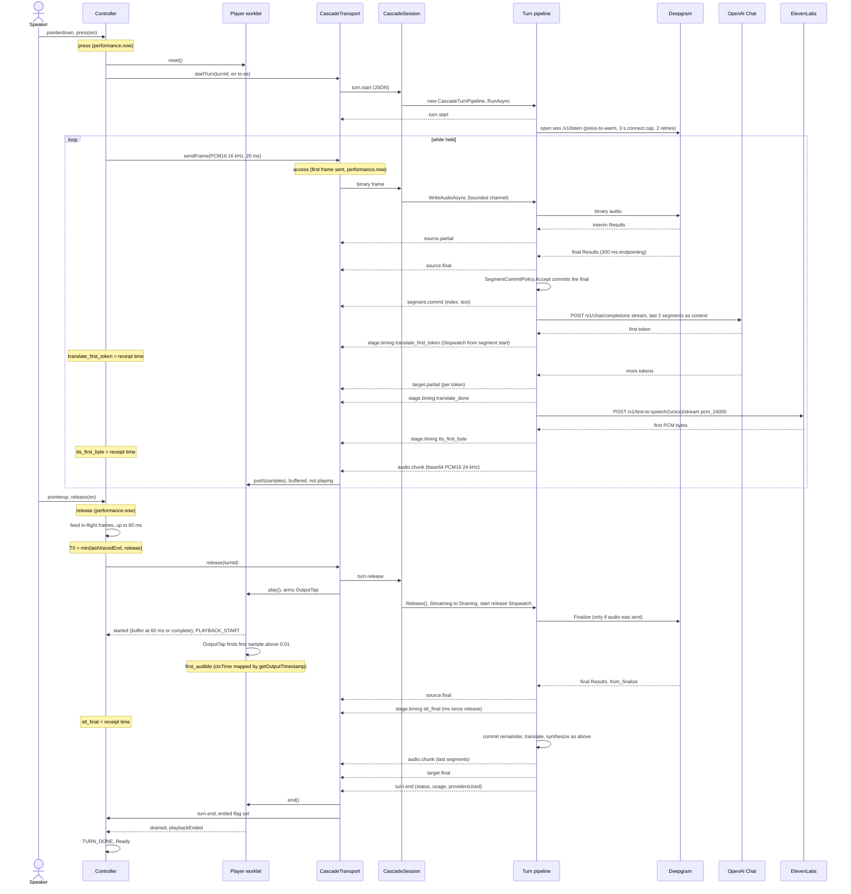
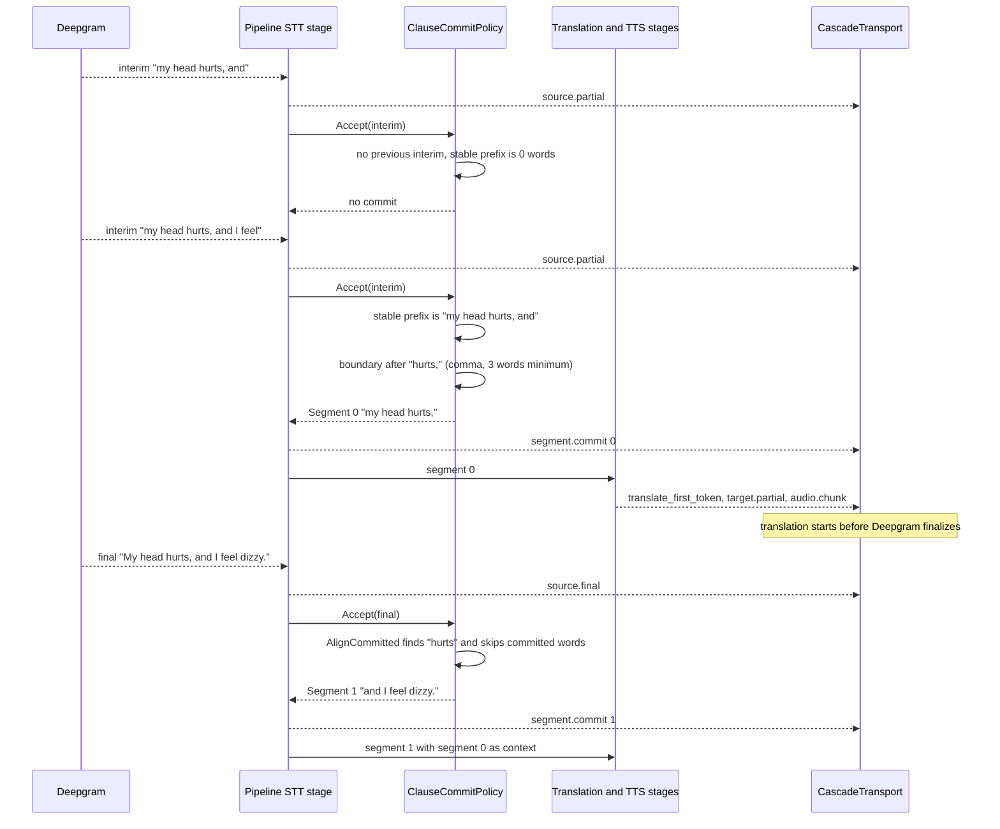
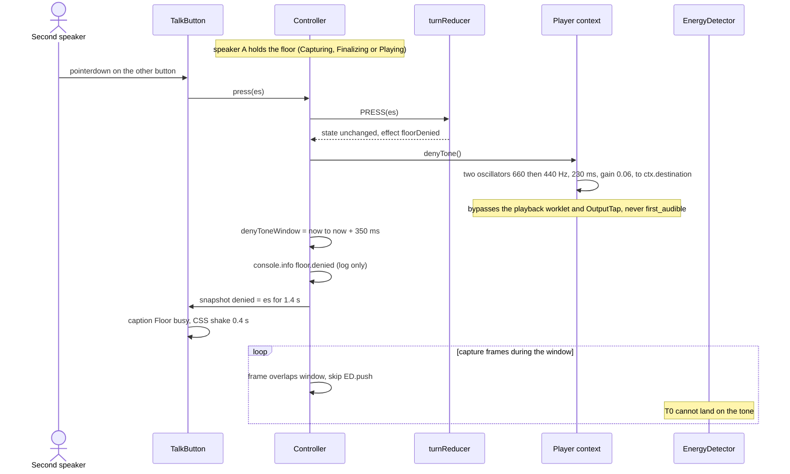
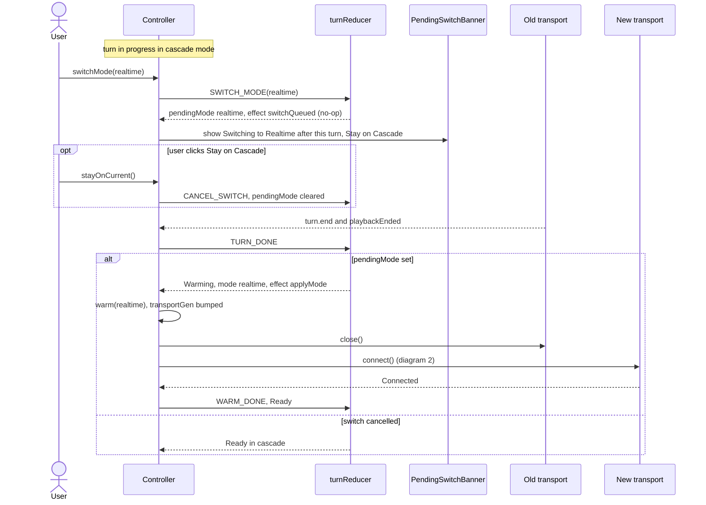
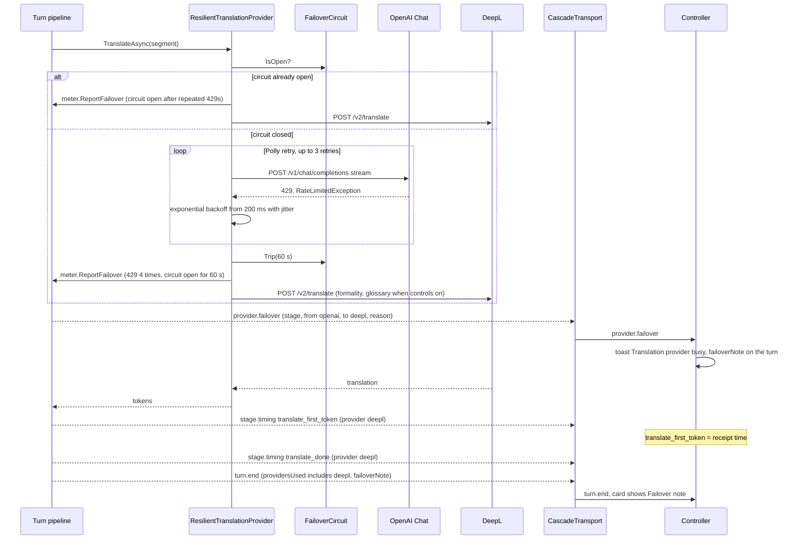
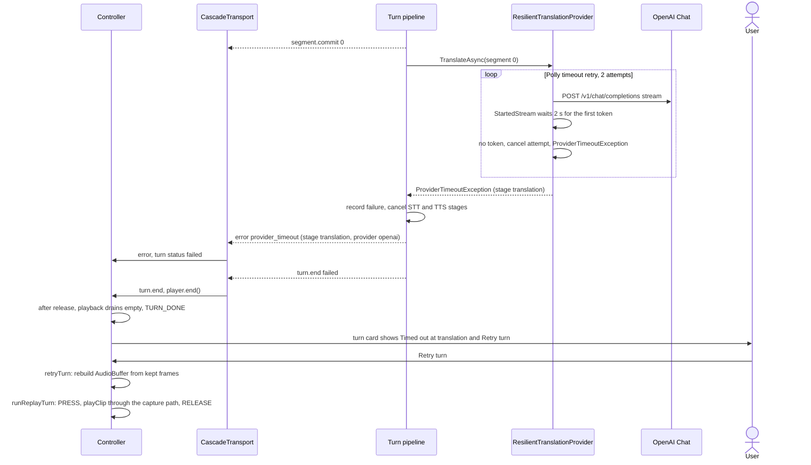
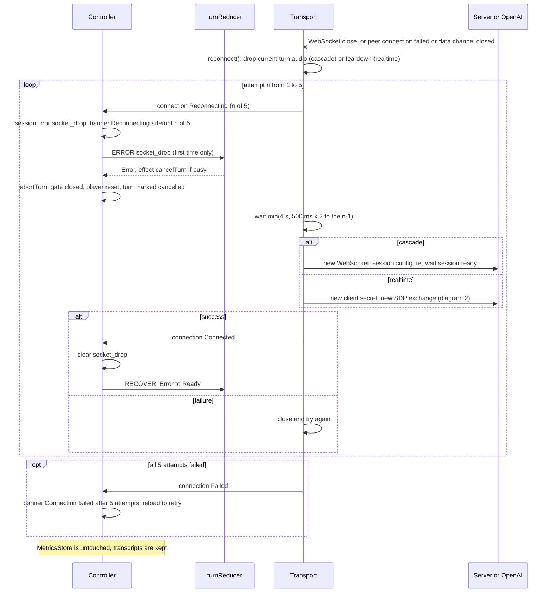

# Sequence diagrams (as built)

Source: as built at commit fdc469c (code last changed in 7e168f9).

Related: [hla.md](hla.md) (high-level architecture) and [lla.md](lla.md) (low-level architecture).

These diagrams describe what the code does, not the pre-build plan in
[../architecture.md](../architecture.md). Where the two differ, a "Differs from the
pre-build spec" line says so.

**Clocks.** Browser marks are `performance.now()` milliseconds. The server never
sends absolute times for marks: it sends `stage.timing` events carrying a
`System.Diagnostics.Stopwatch` duration, and the browser stores the duration and
sets the mark to the browser time the event arrived (`receivedAt`). Mark names
below use the wire names (`stt_final`); the client stores them in camelCase
(`sttFinal`) in `client/src/state/metrics.ts`.

Contents:

1. [Warm-up](#1-warm-up)
2. [Realtime client-secret mint and WebRTC connect](#2-realtime-client-secret-mint-and-webrtc-connect)
3. [A Realtime turn](#3-a-realtime-turn)
4. [A cascade turn, segment commit](#4-a-cascade-turn-segment-commit)
5. [Clause-commit variant](#5-clause-commit-variant)
6. [Floor deny](#6-floor-deny)
7. [Mid-session mode switch](#7-mid-session-mode-switch)
8. [429 retry and DeepL failover](#8-429-retry-and-deepl-failover)
9. [Provider timeout](#9-provider-timeout)
10. [Socket drop and reconnect](#10-socket-drop-and-reconnect)
11. [Timing marks reference](#timing-marks-reference)

## 1. Warm-up

`App.tsx` calls `controller.start()` once. It loads health, config and clips in
parallel, initializes both audio contexts, opens the mic, then calls `warm(mode)`.
The cascade transport resolves only on `session.ready` (client cap 15 s, else
`provider_timeout`). Server warm-up opens pooled HTTP/TLS connections and checks
keys. It does not open the Deepgram stream, which opens on press (diagram 4).
`KeepWarmLoopAsync` repeats the warm-up after 45 s idle. Realtime warm-up is
diagram 2. A mode switch reuses `warm()` (diagram 7).

## 2. Realtime client-secret mint and WebRTC connect

The API key stays on the server. `RealtimeSessionClient.CreateAsync` mints the
secret with the first direction's prompt, and returns both directions' prompts so
the browser can retarget per press. The browser then does the SDP exchange directly
with OpenAI. Playback goes through an `<audio>` element. The `RemoteAudioTap`
AnalyserNode only listens.

## 3. A Realtime turn

The mic track is attached to the peer connection for the whole session. Push-to-talk
works by opening and closing a GainNode gate in `CaptureEngine`, not by toggling
`track.enabled`. Commit and `response.create` are sent from `completeRelease`, up
to 80 ms after pointerup. `eventMapper.ts` maps data-channel events and prunes
context to `CONTEXT_TURNS = 2`. The source transcript comes from the side
transcription model and may land after the audio.

## 4. A cascade turn, segment commit

`CascadeTurnPipeline` runs STT, translation and TTS as three tasks joined by bounded
channels, so translated audio for early segments is already in the browser's jitter
buffer at release. `stt_final` is emitted only for finals that arrive after release.
Deepgram's stream ends when a final covers all audio sent, or after 1.5 s of quiet
after release. Stage marks take the receipt time of the latest segment's event.

Note: playback starts at `completeRelease` (up to 80 ms after pointerup), once the
worklet holds 60 ms of audio or the turn's audio is complete. CLAUDE.md says "on
button release". This is the as-built meaning.

## 5. Clause-commit variant

`ClauseCommitPolicy` treats the word prefix unchanged between two consecutive
interims as stable. It commits at `, ; :` (3 words minimum), at `. ? !`, or before
a stable conjunction (EN, ES and FR lists). Committed words are never re-sent. A
later STT revision of committed words is not re-translated. The strategy is set per
session by `session.configure`. Changing it re-warms the transport.

## 6. Floor deny

The reducer returns `floorDenied` for any press while the phase is busy, and the
state does not change. The owner's own repeat press while Capturing is ignored, and
a press in Warming or Error gets the "Not ready" flash instead. Frames inside the
deny window still go to the transport and the retry buffer. They are only kept out
of the energy detector.

Differs from the pre-build spec: no `floor.denied` event is sent or recorded. The
type exists in both contracts, but the press is only logged to the console.

## 7. Mid-session mode switch

While busy, `SWITCH_MODE` only records `pendingMode`. `backToReady` applies it when
the turn finishes. `transportGen` makes signals from the old transport stale. The
metrics store is not cleared, so transcripts survive the switch.

Differs from the pre-build spec: a switch also applies at once in Warming, and in
Error when the code is `internal` or `config_error` (to escape a mode that cannot
start). Other errors queue the switch.

## 8. 429 retry and DeepL failover

Retries happen only before the first token. `StartedStream` wraps "open the stream
and get the first item", so nothing has gone downstream yet. The retry predicate
also covers retryable 5xx. `TurnMeter.ReportFailover` reports only the first
failover of a turn. The circuit is shared per real provider across sessions, so
later segments and turns go straight to DeepL for 60 s.

Differs from the pre-build spec: only translation has a breaker and failover. TTS
has the same Polly retry but no fallback. STT is not wrapped in Polly: Deepgram's
connect has its own 2-retry jittered loop.

## 9. Provider timeout

The same path covers TTS (2 s first byte), and a stream that stalls for 5 s after its
first item, which is not retried. The STT watchdog fires 2 s after release. It
flushes the last interim and fails with `provider_timeout` (stage `stt`) only when
nothing was committed. In Realtime mode, no `response.created` within 5 s of release
emits `provider_timeout` (stage `response`) and a failed `turn.end`.

Differs from the pre-build spec: the STT final timeout has no retry, because after
release there is no audio left to resend. The 5 s stream-stall timeout and the 5 s
Realtime response timeout are additions.

## 10. Socket drop and reconnect

Both transports use the same loop: `MAX_RECONNECTS = 5`, backoff 0.5, 1, 2, 4, 4 s.
An explicit `close()` sets `closed` and stops reconnects, so a mode switch never
triggers one. `RECOVER` also applies a queued mode switch. The soak test calls
`forceDrop()` to exercise this path. On the server, a closed socket cancels the
active pipeline in `CascadeSession.RunAsync`.

## Timing marks reference

| mark | captured in (file:function) | clock | appears in diagrams # |
|---|---|---|---|
| press | `client/src/session/controller.ts:startTurn` (via `MetricsStore.startTurn`, called synchronously from the pointerdown handler) | browser `performance.now()` | 3, 4 |
| access | cascade: `client/src/transports/cascade/CascadeTransport.ts:sendFrame` (first frame sent). Realtime: `client/src/transports/realtime/RealtimeTransport.ts:startTurn` (track already live) | browser `performance.now()` | 3, 4 |
| speechStart | `client/src/session/controller.ts:onFrame` (EnergyDetector `speech_start`) | browser, capture frame time (`captureEngine.ts` maps worklet time to `performance.now()` minus input latency) | 3 |
| T0 | `client/src/session/controller.ts:completeRelease` (`setMark t0 = min(detector.lastVoicedEnd, release)`) | browser, capture frame time | 3, 4 |
| release | `client/src/session/controller.ts:releaseTurn` | browser `performance.now()` | 3, 4 |
| stt_final | server `server/src/Workbench.Core/Pipeline/CascadeTurnPipeline.cs:RunSttAsync` (ms since release). Mark set in `client/src/state/metrics.ts:MetricsStore.stage` | server Stopwatch duration, mark = browser receipt time from `CascadeTransport.onMessage` | 4 |
| translate_first_token | server `CascadeTurnPipeline.cs:RunTranslationAsync` (ms from segment start). Mark in `MetricsStore.stage` | server Stopwatch duration, mark = browser receipt time | 4, 5, 8 |
| translate_done | server `CascadeTurnPipeline.cs:RunTranslationAsync`. Mark in `MetricsStore.stage` | server Stopwatch duration, mark = browser receipt time | 4, 8 |
| tts_first_byte | server `CascadeTurnPipeline.cs:RunTtsAsync` (ms from synthesis start). Mark in `MetricsStore.stage` | server Stopwatch duration, mark = browser receipt time | 4 |
| rt_response_start | `client/src/transports/realtime/eventMapper.ts:handle` on `response.created`, with `now` from `RealtimeTransport.ts:onServerEvent` | browser `performance.now()` on data-channel receipt | 3 |
| first_audible | cascade: `client/src/audio/worklets/playback.worklet.ts:process` (OutputTap) mapped by `client/src/audio/player.ts` via `clock.ts:ctxTimeToPerf`. Realtime: `client/src/audio/remoteTap.ts:arm` (AnalyserNode poll) | cascade: AudioContext time mapped to `performance.now()` with `getOutputTimestamp`. Realtime: `performance.now()` in a 5 ms poll | 3, 4 |

Headline metric: mouth-to-ear = `first_audible - T0`. Access time = `access - press`.
Both are computed in `client/src/state/metrics.ts`. Stage marks keep the latest
segment's receipt time. All other marks are first-write-wins, except T0, which
`setMark` overwrites at release.
